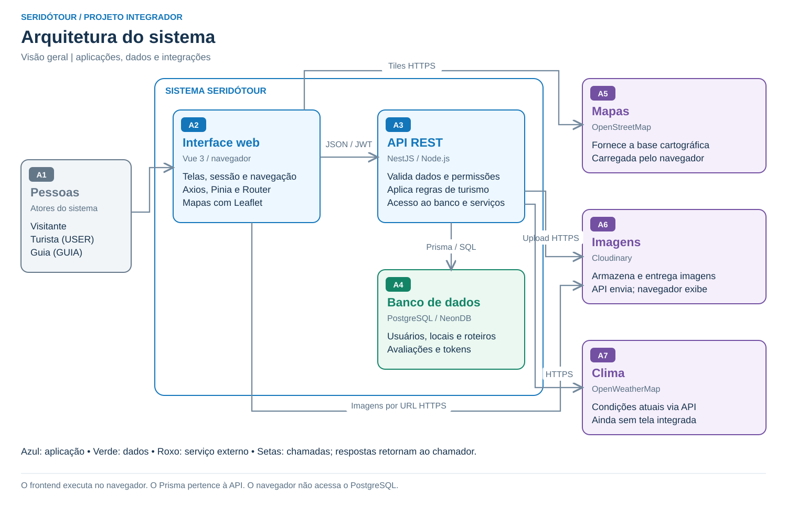
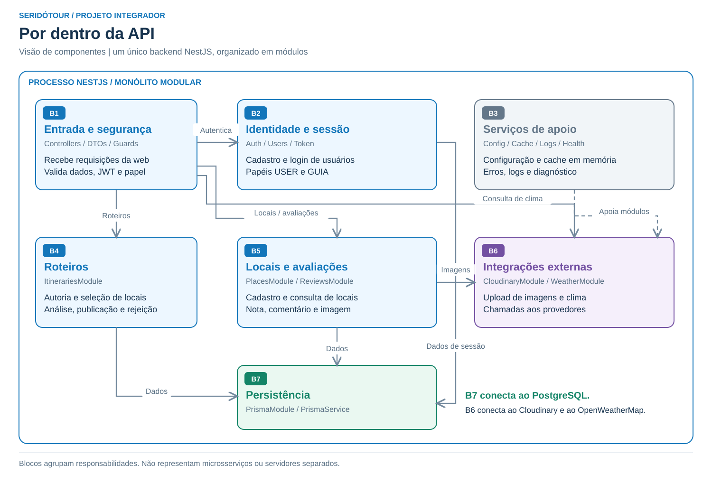
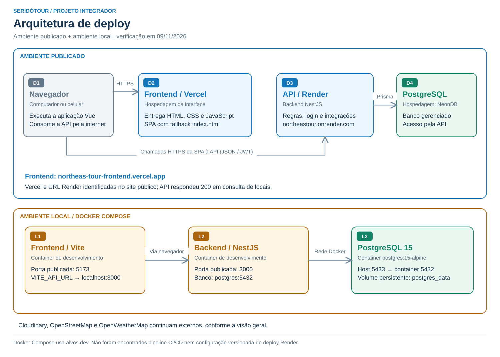

# Arquitetura do SeridóTour

O SeridóTour é uma aplicação web com interface Vue 3, API NestJS e banco PostgreSQL. O código fica em um monorepo com as pastas `apps/frontend` e `apps/backend`. A API é um **monólito modular**: seus módulos funcionam no mesmo processo.

## 1. Visão geral

[Imagem PNG](diagramas/arquitetura-sistema.png) · [SVG editável](diagramas/arquitetura-sistema.svg)

| Bloco | Explicação |
| --- | --- |
| A1 - Pessoas | Visitante consulta informações públicas; turista cria roteiros e avaliações; guia também gerencia locais, consulta usuários e modera roteiros. No banco, os papéis são USER e GUIA. |
| A2 - Interface web | Vue 3 apresenta telas e formulários. Vue Router controla a navegação, Pinia mantém a sessão e Axios envia chamadas à API. Leaflet apresenta os mapas. O código da interface executa no navegador. |
| A3 - API REST | NestJS recebe as chamadas, valida dados e permissões e aplica regras de negócio. JWT identifica o usuário; o papel GUIA libera as operações administrativas. |
| A4 - Banco de dados | PostgreSQL, hospedado no NeonDB em produção, armazena usuários, tokens, locais, roteiros e avaliações. Prisma faz o acesso ao banco dentro da API. Imagens são armazenadas como URLs. |
| A5 - OpenStreetMap | Fornece as imagens da base do mapa diretamente ao navegador. Os marcadores usam coordenadas dos locais cadastrados. Não há cálculo automático de trajetos. |
| A6 - Cloudinary | Recebe imagens enviadas pelo backend. O banco guarda a URL retornada e o navegador usa essa URL para exibir a imagem. |
| A7 - OpenWeatherMap | Fornece condições meteorológicas atuais, consultadas pelo backend. A função existe na API, mas a tela de roteiro ainda não a utiliza. |

### Exemplo de funcionamento

1. O turista abre a interface e faz login; a API entrega um token de acesso.
2. Ao criar um roteiro, a interface envia os dados, os locais selecionados e o token.
3. A API verifica a sessão, salva o roteiro como rascunho por meio do Prisma e retorna o resultado.
4. O autor envia o roteiro para análise. O guia publica ou rejeita; somente os publicados aparecem na consulta pública.
5. Em um cadastro com imagem, a API envia o arquivo ao Cloudinary e grava a URL no PostgreSQL.

## 2. Componentes da API

[Imagem PNG](diagramas/arquitetura-modulos.png) · [SVG editável](diagramas/arquitetura-modulos.svg)

| Bloco | Explicação |
| --- | --- |
| B1 - Entrada e segurança | Controllers recebem as requisições. DTOs e validações conferem campos e arquivos. Guards verificam o token JWT e, quando necessário, o papel de guia. |
| B2 - Identidade e sessão | Auth, Users e Token cuidam do cadastro, senha protegida, login, papéis e registro de tokens. O gerenciamento de usuários disponível permite somente listar contas. |
| B3 - Serviços de apoio | Config carrega variáveis de ambiente; cache em memória reaproveita algumas consultas; logs e filtros registram e padronizam erros; Health expõe o diagnóstico em /health. Swagger documenta a API em /api-docs quando habilitado. |
| B4 - Roteiros | Itineraries controla autor, título, duração, locais e situação. Um roteiro em análise não pode ser editado. O autor envia para análise e o guia publica, rejeita ou despublica. |
| B5 - Locais e avaliações | Places mantém os pontos turísticos. Reviews registra nota, comentário, autor, local e imagem opcional. O comentário é parte da avaliação. |
| B6 - Integrações externas | CloudinaryModule encapsula o upload de imagens. WeatherModule consulta OpenWeatherMap e trata falhas do provedor. Mapas não passam por esse módulo: o navegador consulta OpenStreetMap. |
| B7 - Persistência | PrismaService é usado pelos módulos que consultam ou alteram dados. O schema Prisma define entidades e relacionamentos no PostgreSQL. Não é um servidor separado. |

O bloco B3 apoia os demais módulos. O cache é local ao processo e não usa Redis. Os blocos do desenho são agrupamentos para facilitar a leitura, não microsserviços.

## 3. Deploy e ambiente local

[Imagem PNG](diagramas/arquitetura-deploy.png) · [SVG editável](diagramas/arquitetura-deploy.svg)

### Ambiente publicado

| Bloco | Explicação |
| --- | --- |
| D1 - Navegador | Baixa a interface e executa o Vue. Depois faz chamadas HTTPS diretamente à API, enviando o token nas operações protegidas. |
| D2 - Vercel | Hospeda o frontend em [northeas-tour-frontend.vercel.app](https://northeas-tour-frontend.vercel.app). A configuração vercel.json redireciona rotas da SPA para index.html. |
| D3 - Render | Hospeda a API configurada no frontend em [northeastour.onrender.com](https://northeastour.onrender.com). O backend atende chamadas, aplica regras e consulta banco e integrações. |
| D4 - PostgreSQL / NeonDB | Banco PostgreSQL hospedado no NeonDB. A API no Render acessa o banco por DATABASE_URL, utilizando o Prisma. |

**Evidência:** em 09/11/2026 o site Vercel serviu um bundle JavaScript que configura a URL Render como base da API. Uma consulta pública a [GET /places?limit=1](https://northeastour.onrender.com/places?limit=1) respondeu HTTP 200. A hospedagem do PostgreSQL no NeonDB foi informada pelo responsável pelo projeto. O commit implantado não foi identificado. O registro está em [deploy-verificado.json](diagramas/deploy-verificado.json).

### Ambiente local com Docker Compose

| Bloco | Explicação |
| --- | --- |
| L1 - Frontend | Container com Vite, disponível por padrão em localhost:5173. VITE_API_URL aponta para localhost:3000 porque a chamada à API parte do navegador no computador do usuário. |
| L2 - Backend | Container NestJS, publicado em localhost:3000. Acessa o banco pelo nome postgres e porta interna 5432. Na inicialização atual gera o cliente Prisma, sincroniza o schema com db push e inicia o modo de desenvolvimento. |
| L3 - PostgreSQL | Container postgres:15-alpine. Publica a porta 5433 do computador para 5432 do container; o volume postgres_data mantém os dados. |

O Compose usa os alvos **dev** dos Dockerfiles. Também existem alvos **prod**: frontend com arquivos compilados e Nginx, backend com Node.js. A presença desses alvos não comprova que o deploy Render os utiliza. Não foi encontrada configuração versionada de pipeline CI/CD nem do serviço Render.

### Configurações para a comunicação

- VITE_API_URL: endereço da API usado na compilação do frontend publicado.
- CORS_ORIGIN: origem do frontend permitida pelo backend.
- DATABASE_URL: conexão do backend com PostgreSQL no NeonDB em produção; no Docker local, aponta para o serviço postgres.
- JWT_SECRET e variáveis de expiração: assinatura e duração da sessão.
- CLOUDINARY_* e OPENWEATHER_API_KEY: credenciais dos serviços externos, usadas pelo backend.

Segredos ficam no ambiente do backend, sem serem incluídos nos diagramas ou na interface. As portas 5173, 3000 e 5433 são padrões locais, não endereços públicos de produção.

## 4. Fontes

- [Código do SeridóTour](https://github.com/SeridoTour/SeridoTour), base local main: 0dd906a31a582a196f68c03534e222574416b1d7.
- [AppModule](../apps/backend/src/app.module.ts), [main.ts](../apps/backend/src/main.ts), [schema Prisma](../apps/backend/prisma/schema.prisma) e [cliente Axios](../apps/frontend/src/services/api.ts).
- [Docker Compose](../docker-compose.yml), [Dockerfile backend](../apps/backend/Dockerfile), [Dockerfile frontend](../apps/frontend/Dockerfile) e [vercel.json](../apps/frontend/vercel.json).
- Referências visuais: [visão de aplicações e dados do modelo C4](https://c4model.com/diagrams/container) e [diagramas de deploy C4](https://c4model.com/diagrams/deployment). Desenhos próprios com notação livre de blocos, permitida na atividade.

As setas mostram chamadas ou dependências; as respostas retornam ao chamador. A relação N:M do DER não tem direção.
