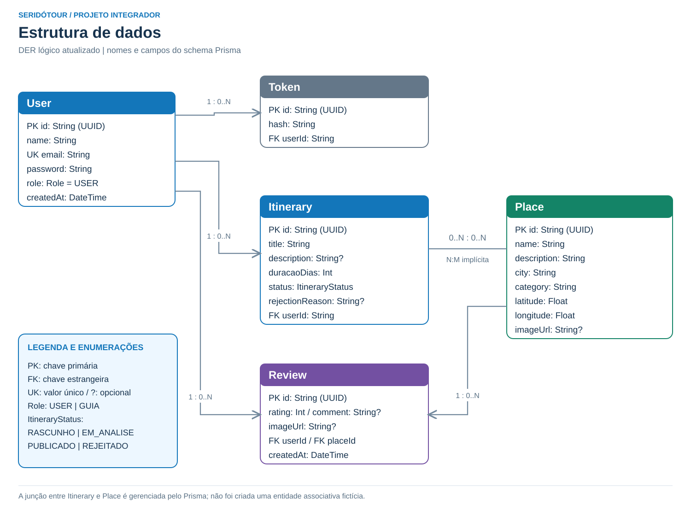

# Estrutura de dados do SeridóTour

O SeridóTour utiliza PostgreSQL e Prisma para guardar usuários, tokens, locais turísticos, roteiros e avaliações. Em produção, o PostgreSQL é hospedado no NeonDB; no ambiente local, é executado pelo Docker Compose. O diagrama abaixo acompanha o [schema atual do projeto](../apps/backend/prisma/schema.prisma).

Versões do diagrama: [SVG](diagramas/estrutura-de-dados.svg) e [PNG](diagramas/estrutura-de-dados.png).

## Legenda

- **PK:** chave primária, que identifica cada registro.
- **FK:** chave estrangeira, que relaciona o registro a outra entidade.
- **Único:** valor que não pode se repetir.
- **Opcional:** campo que aceita valor nulo no banco. Os demais campos são obrigatórios.
- **0..N:** nenhum ou vários registros relacionados.

## 1. Usuário — `User`

Representa a pessoa cadastrada e seu perfil de acesso.

| Campo | Tipo | Descrição |
| --- | --- | --- |
| `id` | Texto | PK gerada como UUID. |
| `name` | Texto | Nome do usuário. |
| `email` | Texto | E-mail único. |
| `password` | Texto | Senha armazenada em hash. |
| `role` | `Role` | Perfil de acesso; padrão `USER`. |
| `createdAt` | Data e hora | Data de cadastro, preenchida automaticamente. |

Um usuário pode criar nenhum ou vários roteiros, avaliações e tokens. Cada um desses registros pertence a um único usuário.

## 2. Token — `Token`

Guarda o token associado à conta para o controle de sessão.

| Campo | Tipo | Descrição |
| --- | --- | --- |
| `id` | Texto | PK gerada como UUID. |
| `hash` | Texto | Valor do token armazenado pela aplicação. |
| `userId` | Texto | FK para `User.id`. |

O modelo permite vários tokens por usuário. Isso descreve a estrutura do banco; a aplicação pode manter uma quantidade menor conforme suas regras de sessão.

## 3. Local turístico — `Place`

Reúne as informações necessárias para apresentar um ponto turístico e localizá-lo no mapa.

| Campo | Tipo | Descrição |
| --- | --- | --- |
| `id` | Texto | PK gerada como UUID. |
| `name` | Texto | Nome do local. |
| `description` | Texto | Descrição do ponto turístico. |
| `city` | Texto | Cidade em que está localizado. |
| `category` | Texto | Categoria do local. |
| `latitude` | Decimal | Coordenada de latitude. |
| `longitude` | Decimal | Coordenada de longitude. |
| `imageUrl` | Texto opcional | Endereço da imagem hospedada no Cloudinary. |

Um local pode receber nenhuma ou várias avaliações e participar de nenhum ou vários roteiros.

## 4. Roteiro turístico — `Itinerary`

Representa o planejamento criado pelo usuário e sua situação no processo de publicação.

| Campo | Tipo | Descrição |
| --- | --- | --- |
| `id` | Texto | PK gerada como UUID. |
| `title` | Texto | Título do roteiro. |
| `description` | Texto opcional | Descrição do planejamento. |
| `duracaoDias` | Inteiro | Duração do roteiro em dias. |
| `status` | `ItineraryStatus` | Situação de publicação; padrão `RASCUNHO`. |
| `rejectionReason` | Texto opcional | Motivo informado quando o roteiro é rejeitado. |
| `userId` | Texto | FK para `User.id`, identificando o autor. |

Cada roteiro tem um autor e pode se relacionar com vários locais. O formulário exige a seleção de pelo menos um local, mas essa exigência não é uma cardinalidade mínima declarada no schema do banco.

## 5. Avaliação — `Review`

Registra a experiência de um usuário em um local. O comentário faz parte da própria avaliação.

| Campo | Tipo | Descrição |
| --- | --- | --- |
| `id` | Texto | PK gerada como UUID. |
| `rating` | Inteiro | Nota; a criação aceita valores de 1 a 5. |
| `comment` | Texto opcional | Relato sobre a experiência no local. |
| `imageUrl` | Texto opcional | Endereço de uma imagem da avaliação no Cloudinary. |
| `userId` | Texto | FK para `User.id`, identificando o autor. |
| `placeId` | Texto | FK para `Place.id`, identificando o local avaliado. |
| `createdAt` | Data e hora | Data de criação, preenchida automaticamente. |

Cada avaliação pertence a um usuário e a um local. Embora `comment` aceite nulo no banco, o formulário e a validação de criação exigem um comentário preenchido. A nota de 1 a 5 também é uma regra validada na criação.

## Relacionamentos

| Relação | Cardinalidade | Significado |
| --- | --- | --- |
| `User` → `Itinerary` | 1 para 0..N | Um usuário pode ser autor de vários roteiros. |
| `User` → `Review` | 1 para 0..N | Um usuário pode registrar várias avaliações. |
| `User` → `Token` | 1 para 0..N | Um usuário pode ter vários tokens no modelo de dados. |
| `Place` → `Review` | 1 para 0..N | Um local pode receber várias avaliações. |
| `Itinerary` ↔ `Place` | N para M | Um roteiro reúne vários locais; um local pode participar de vários roteiros. |

A relação entre roteiros e locais é **muitos para muitos, implícita no Prisma**. O Prisma administra a associação a partir de `Itinerary.places` e `Place.itineraries`. O schema não declara um modelo intermediário próprio nem um identificador UUID para essa associação.

## Valores dos perfis e estados

| Campo | Valores permitidos |
| --- | --- |
| `User.role` | `USER` (turista) e `GUIA` (guia/administrador). |
| `Itinerary.status` | `RASCUNHO`, `EM_ANALISE`, `PUBLICADO` e `REJEITADO`. |

## Estrutura atual

O diagrama inclui `status` e `rejectionReason` no roteiro e `imageUrl` no local e na avaliação. A relação entre roteiros e locais é administrada implicitamente pelo Prisma, sem uma entidade intermediária com UUID declarada no schema. A estrutura apresentada acompanha os nomes e campos do código atual.

**Referências do projeto:** [schema Prisma](../apps/backend/prisma/schema.prisma) e [validação de criação de avaliações](../apps/backend/src/modules/reviews/dto/create-review.dto.ts).
